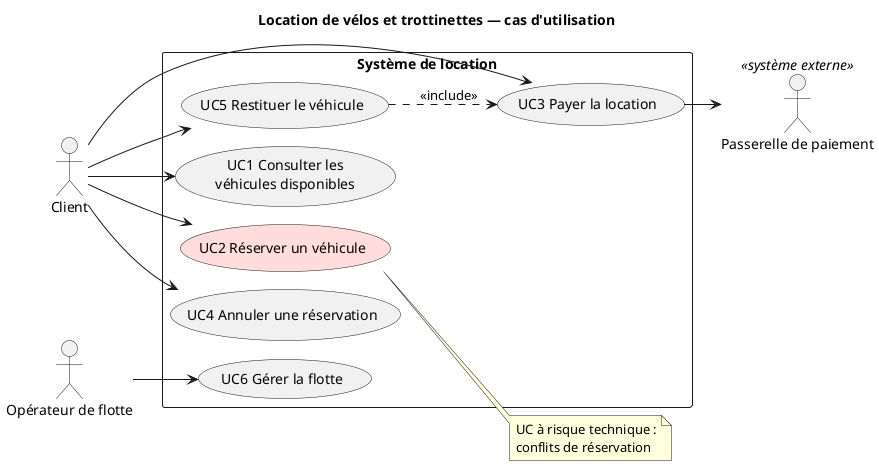
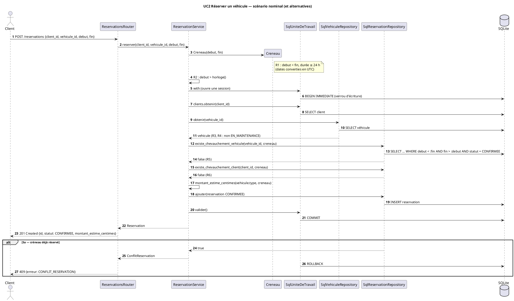

# Location de vélos/trottinettes — Plan d'implémentation

> **For agentic workers:** REQUIRED SUB-SKILL: Use superpowers:subagent-driven-development (recommended) or superpowers:executing-plans to implement this plan task-by-task. Steps use checkbox (`- [ ]`) syntax for tracking.

**Goal:** Livrer le TP1 (cadrage UP, Élaboration avec architecture de base exécutable taguée `v0.1-elaboration`, Construction de UC2 « Réserver un véhicule » complet) dans un dépôt Git local prêt à être poussé sur GitHub.

**Architecture:** API FastAPI en couches : contrôleur (`app/api`) → service (`app/services`, dépend d'interfaces `Protocol` et d'une unité de travail) → accès aux données (`app/repositories`, SQLAlchemy sur SQLite). Le métier pur (`app/domain`) porte `Creneau`, le tarif et les erreurs. Le risque « conflit de réservation » est traité par vérification du chevauchement + insertion dans une transaction `BEGIN IMMEDIATE`.

**Tech Stack:** Python 3.13, FastAPI 0.142.2, SQLAlchemy 2.1.3, SQLite, pytest 9.1.1, httpx 0.28.1, uvicorn 0.54.0, PlantUML, GitHub Actions.

**Spec:** `docs/superpowers/specs/2026-10-07-location-velos-design.md`

## Global Constraints

- Dépendances figées : `fastapi==0.142.2`, `SQLAlchemy==2.1.3`, `httpx==0.28.1`, `pytest==9.1.1`, `uvicorn==0.54.0`.
- CI : GitHub Actions, Python `3.13`, `pip install -r requirements.txt` puis `pytest -v`.
- Langue : documents et identifiants métier en français (comme dans la spec).
- Environnement local : Windows + Git Bash ; venv déjà créé dans `.venv` ; lancer Python par `.venv/Scripts/python`. Toutes les commandes depuis la racine `C:/Users/Mohamed/Desktop/PU/TP1`.
- Chaque message de commit se termine par la ligne `Co-Authored-By: Claude Opus 5.5 <noreply@anthropic.com>` (précédée d'une ligne vide).
- Montants : entiers en centimes, champ `montant_estime_centimes` (précise le `montant_estime` de la spec ; mettre la spec à jour en Task 11).
- Dates : stockées en UTC « naïf » (sans tzinfo) ; une date sans fuseau reçue est considérée UTC.
- Chevauchement : `a.debut < b.fin and b.debut < a.fin` ; créneaux contigus = pas de conflit ; seules les réservations `CONFIRMEE` comptent.
- Pas de `git push` : le remote sera fourni plus tard par l'utilisateur.
- Branches UC : `uc1-consulter-disponibilites`, `uc2-reserver-vehicule`, `uc3-payer-location`, `uc4-annuler-reservation`, `uc5-restituer-vehicule`, `uc6-gerer-flotte`. Tags de phase : `v0.0-lancement`, `v0.1-elaboration` (posés dans ce plan), `v0.2-construction`, `v1.0-transition` (futurs).

## Review Focus

1. Dates avec fuseau (`...+02:00` / `Z`) mélangées à des dates sans fuseau → aucune erreur 500, conversion en UTC puis détection de conflit correcte (tests : Task 8 `test_normalise_en_utc_naif`, Task 10 `test_date_avec_fuseau_convertie_en_utc_et_conflit_detecte`).
2. Réservation `ANNULEE` sur le même créneau → ne bloque pas une nouvelle réservation (Task 5 `test_ignore_reservation_annulee`, Task 9 `test_reservation_annulee_ne_bloque_pas`).
3. Créneaux contigus (fin de l'une = début de l'autre) → acceptés (Task 4 `test_creneaux_contigus_ne_se_chevauchent_pas`, Task 5 `test_detecte_chevauchement_avec_reservation_confirmee`).
4. Bornes de durée : exactement 24 h accepté, 24 h + 1 s refusé ; 1 h + 1 µs facturé 2 h (Task 8).
5. Début exactement égal à « maintenant » → refusé (R2 strict) (Task 9 `test_r2_debut_egal_a_maintenant_refuse`).

---

## Phase Lancement

### Task 1: Documents de cadrage + tag `v0.0-lancement`

**Files:**
- Create: `docs/01-vision.md`, `docs/02-cas-utilisation.md`, `docs/03-plan-iterations.md`, `README.md`

**Interfaces:**
- Consumes: spec §2.
- Produces: documents référencés par les tickets (Task 2) et le README.

- [ ] **Step 1: Écrire `docs/01-vision.md`**

```markdown
# Vision — Location de vélos et trottinettes

## Vision (5 lignes)

1. **Problème** : louer un vélo ou une trottinette en station se fait sans garantie de disponibilité ; doubles réservations et manque de visibilité frustrent les usagers.
2. **Utilisateurs** : clients (étudiants, salariés, touristes) et opérateurs de flotte.
3. **Valeur client** : réserver en ligne un véhicule sur un créneau garanti sans conflit, payer et restituer simplement.
4. **Valeur opérateur** : visibilité sur la flotte, moins de litiges.
5. **Périmètre** : API web, stations fixes, paiement via une passerelle externe simulée.

## Acteurs

| Acteur | Type | Rôle |
|---|---|---|
| Client | principal | consulte, réserve, paie, annule, restitue |
| Opérateur de flotte | principal | gère les véhicules (ajout, retrait, maintenance) |
| Passerelle de paiement | secondaire (système externe) | autorise et capture les paiements |
```

- [ ] **Step 2: Écrire `docs/02-cas-utilisation.md`**

```markdown
# Cas d'utilisation et priorisation

## Liste des UC

| # | Cas d'utilisation | Acteur(s) | Description courte |
|---|---|---|---|
| UC1 | Consulter les véhicules disponibles | Client | lister les véhicules libres d'une station sur un créneau |
| UC2 | Réserver un véhicule | Client | bloquer un véhicule sur un créneau — **UC à risque technique : conflits de réservation** |
| UC3 | Payer la location | Client, Passerelle de paiement | régler le montant via la passerelle externe |
| UC4 | Annuler une réservation | Client | libérer un créneau réservé |
| UC5 | Restituer le véhicule | Client | clore la location, calculer le prix final (inclut UC3) |
| UC6 | Gérer la flotte | Opérateur de flotte | ajouter, retirer, mettre en maintenance un véhicule |

Diagramme : [`uml/cas-utilisation.puml`](uml/cas-utilisation.puml).

## Priorisation

Notes de 1 (faible) à 3 (fort).

| UC | Valeur métier | Risque | Impact architecture | Total | Itération |
|---|---|---|---|---|---|
| UC2 Réserver un véhicule | 3 | 3 | 3 | **9** | It1 (Élaboration) |
| UC3 Payer la location | 3 | 3 | 2 | 8 | It2 |
| UC1 Consulter les disponibilités | 3 | 1 | 2 | 6 | It1 |
| UC5 Restituer le véhicule | 2 | 2 | 2 | 6 | It2 |
| UC6 Gérer la flotte | 2 | 1 | 2 | 5 | It3 |
| UC4 Annuler une réservation | 2 | 1 | 1 | 4 | It3 |

**À traiter en premier : UC2** (score maximal sur les trois critères : il fixe le modèle de données, la
gestion transactionnelle et la stratégie anti-conflit), puis **UC3** (intégration externe risquée).
```

- [ ] **Step 3: Écrire `docs/03-plan-iterations.md`**

```markdown
# Plan des itérations, phases et jalons (Processus Unifié)

| Phase | Itération | Contenu | Jalon | Tag |
|---|---|---|---|---|
| Lancement | — (cadrage) | vision, acteurs, UC, priorisation, plan | LCO — Objectifs du cycle de vie | `v0.0-lancement` |
| Élaboration | It1 | architecture de base exécutable : `POST /reservations` de bout en bout (UC2), CI verte ; UC1 en lecture | LCA — Architecture du cycle de vie | `v0.1-elaboration` |
| Construction | It2 | UC2 complet (règles, alternatives, concurrence), UC3, UC5 | — | — |
| Construction | It3 | UC4, UC6 | IOC — Capacité opérationnelle initiale | `v0.2-construction` |
| Transition | fin It3 | revue croisée, recette, documentation de déploiement | PR — Livraison du produit | `v1.0-transition` |

## Itérations

- **It1 (Élaboration)** — objectif : lever le risque technique. Livrable : route bout-en-bout contrôleur → service → accès aux données pour UC2, premier test automatisé en CI.
- **It2 (Construction)** — UC2 complet (fiche, classes, séquence, tests unitaires + intégration), UC3, UC5.
- **It3 (Construction → Transition)** — UC4, UC6, revue croisée, stabilisation, livraison.

## Correspondance GitHub

- Milestones = phases : `Lancement`, `Élaboration`, `Construction`, `Transition`.
- Tickets = UC (UC1…UC6) + un ticket par livrable de phase.
- Une branche par UC ; jalons de phase = tags Git.
```

- [ ] **Step 4: Écrire `README.md`**

```markdown
# Location de vélos et trottinettes — TP1 Processus Unifié

Petit système de location (6 cas d'utilisation) développé selon le Processus Unifié.

## Documents

- [Vision et acteurs](docs/01-vision.md)
- [Cas d'utilisation et priorisation](docs/02-cas-utilisation.md)
- [Plan des itérations, phases et jalons](docs/03-plan-iterations.md)

## Jalons (tags)

| Tag | Phase |
|---|---|
| `v0.0-lancement` | Lancement terminé (LCO) |
| `v0.1-elaboration` | Architecture de base exécutable (LCA) |
```

- [ ] **Step 5: Commit et tag**

```bash
git add docs/01-vision.md docs/02-cas-utilisation.md docs/03-plan-iterations.md README.md
git commit -m "docs: vision, acteurs, UC, priorisation et plan d'itérations

Co-Authored-By: Claude Opus 5.5 <noreply@anthropic.com>"
git tag -a v0.0-lancement -m "Jalon LCO : fin de la phase de Lancement"
git tag -n
```
Expected: `v0.0-lancement   Jalon LCO : fin de la phase de Lancement`

---

## Phase Élaboration (Partie 1)

### Task 2: Préparation GitHub (tickets, milestones, project board) + branches UC

**Files:**
- Create: `github/issues/01-UC1-consulter-disponibilites.md` … `06-UC6-gerer-flotte.md`, `github/issues/07-lancement.md`, `github/issues/08-elaboration-architecture.md`, `github/issues/09-transition-revue.md`, `github/milestones.md`, `github/setup-github.sh`

**Interfaces:**
- Produces: numéros de tickets attendus sur un dépôt neuf : UC1 = #1 … UC6 = #6, Lancement = #7, Élaboration = #8, Transition = #9 (utilisés dans les messages de merge : « Closes #8 », « Closes #2 »).

- [ ] **Step 1: Écrire les 9 fichiers de tickets.** Format : 1re ligne `# <titre>`, puis lignes `Milestone:` et `Labels:`, puis le corps. Contenu exact :

`github/issues/01-UC1-consulter-disponibilites.md`
```markdown
# UC1 — Consulter les véhicules disponibles
Milestone: Construction
Labels: cas-utilisation

**Acteur** : Client
**Objectif** : lister les véhicules libres d'une station sur un créneau.
**Branche** : `uc1-consulter-disponibilites`
**Priorité** : V3 / R1 / A2 = 6 — It1 (lecture)
```

`github/issues/02-UC2-reserver-vehicule.md`
```markdown
# UC2 — Réserver un véhicule
Milestone: Construction
Labels: cas-utilisation, risque-technique

**Acteur** : Client
**Objectif** : bloquer un véhicule sur un créneau sans conflit.
**Risque technique** : conflits de réservation (chevauchement, accès concurrents).
**Branche** : `uc2-reserver-vehicule`
**Priorité** : V3 / R3 / A3 = 9 — traité en premier (It1 squelette, It2 complet)
**Fiche** : `docs/fiches/UC2-reserver-vehicule.md`
```

`github/issues/03-UC3-payer-location.md`
```markdown
# UC3 — Payer la location
Milestone: Construction
Labels: cas-utilisation, risque-technique

**Acteurs** : Client, Passerelle de paiement
**Objectif** : régler la location via la passerelle externe (simulée).
**Branche** : `uc3-payer-location`
**Priorité** : V3 / R3 / A2 = 8 — It2
```

`github/issues/04-UC4-annuler-reservation.md`
```markdown
# UC4 — Annuler une réservation
Milestone: Construction
Labels: cas-utilisation

**Acteur** : Client
**Objectif** : libérer un créneau réservé.
**Branche** : `uc4-annuler-reservation`
**Priorité** : V2 / R1 / A1 = 4 — It3
```

`github/issues/05-UC5-restituer-vehicule.md`
```markdown
# UC5 — Restituer le véhicule
Milestone: Construction
Labels: cas-utilisation

**Acteur** : Client
**Objectif** : clore la location et calculer le prix final (inclut UC3).
**Branche** : `uc5-restituer-vehicule`
**Priorité** : V2 / R2 / A2 = 6 — It2
```

`github/issues/06-UC6-gerer-flotte.md`
```markdown
# UC6 — Gérer la flotte
Milestone: Construction
Labels: cas-utilisation

**Acteur** : Opérateur de flotte
**Objectif** : ajouter, retirer, mettre en maintenance un véhicule.
**Branche** : `uc6-gerer-flotte`
**Priorité** : V2 / R1 / A2 = 5 — It3
```

`github/issues/07-lancement.md`
```markdown
# Lancement — vision, UC, priorisation, plan
Milestone: Lancement
Labels: phase

Livrables : `docs/01-vision.md`, `docs/02-cas-utilisation.md`, `docs/03-plan-iterations.md`.
Jalon LCO : tag `v0.0-lancement`.
```

`github/issues/08-elaboration-architecture.md`
```markdown
# Élaboration — architecture de base exécutable (UC2)
Milestone: Élaboration
Labels: phase, risque-technique

- [ ] Diagramme de cas d'utilisation PlantUML
- [ ] Route `POST /reservations` : contrôleur → service → accès aux données (SQLite)
- [ ] Premier test automatisé vert en CI (GitHub Actions)
- [ ] Tag `v0.1-elaboration` (jalon LCA)
```

`github/issues/09-transition-revue.md`
```markdown
# Transition — revue croisée et livraison
Milestone: Transition
Labels: phase

- [ ] Revue croisée par une autre équipe (`docs/revue/checklist-revue-croisee.md`)
- [ ] Recette, documentation de déploiement
- [ ] Tag `v1.0-transition`
```

- [ ] **Step 2: Écrire `github/milestones.md`**

```markdown
# Milestones (phases du Processus Unifié)

| Milestone | Jalon | Tag | Tickets | État |
|---|---|---|---|---|
| Lancement | LCO | `v0.0-lancement` | #7 | à fermer |
| Élaboration | LCA | `v0.1-elaboration` | #8 | ouvert |
| Construction | IOC | `v0.2-construction` | #1 à #6 | ouvert |
| Transition | PR | `v1.0-transition` | #9 | ouvert |

Création sur GitHub : `bash github/setup-github.sh <owner>/<repo>` (voir l'en-tête du script).
```

- [ ] **Step 3: Écrire `github/setup-github.sh`**

```bash
#!/usr/bin/env bash
# Crée milestones, labels, tickets et project board sur un dépôt GitHub NEUF,
# pousse branches et tags, puis ferme les milestones des phases terminées.
# Prérequis : gh installé, `gh auth login` puis `gh auth refresh -s project`,
# remote `origin` configuré.
# Usage : bash github/setup-github.sh <owner>/<repo>
set -euo pipefail

REPO="${1:?usage: setup-github.sh <owner>/<repo>}"
OWNER="${REPO%%/*}"
DIR="$(cd "$(dirname "$0")" && pwd)"

for m in "Lancement" "Élaboration" "Construction" "Transition"; do
  gh api "repos/$REPO/milestones" -f title="$m" >/dev/null
done

gh label create cas-utilisation --repo "$REPO" --color 1D76DB --force
gh label create risque-technique --repo "$REPO" --color D93F0B --force
gh label create phase --repo "$REPO" --color 5319E7 --force

PROJECT=$(gh project create --owner "$OWNER" --title "Location vélos — TP1" --format json --jq .number)

# Ordre important : UC1..UC6 = #1..#6, puis #7 Lancement, #8 Élaboration, #9 Transition.
for f in "$DIR"/issues/*.md; do
  title=$(sed -n '1s/^# //p' "$f")
  milestone=$(sed -n 's/^Milestone: //p' "$f")
  labels=$(sed -n 's/^Labels: //p' "$f" | tr -d ' ')
  body=$(tail -n +4 "$f")
  url=$(gh issue create --repo "$REPO" --title "$title" --body "$body" \
        --milestone "$milestone" --label "$labels")
  gh project item-add "$PROJECT" --owner "$OWNER" --url "$url" >/dev/null
  echo "créé : $url"
done

git push --all origin
git push --tags origin

gh issue close 7 --repo "$REPO" --comment "Jalon LCO atteint (tag v0.0-lancement)."
gh issue close 8 --repo "$REPO" --comment "Jalon LCA atteint (tag v0.1-elaboration)." || true
for m in "Lancement" "Élaboration"; do
  num=$(gh api "repos/$REPO/milestones?state=all" --jq ".[] | select(.title==\"$m\") | .number")
  gh api -X PATCH "repos/$REPO/milestones/$num" -f state=closed >/dev/null
  echo "milestone fermé : $m"
done
```

- [ ] **Step 4: Vérifier la syntaxe du script**

Run: `bash -n github/setup-github.sh && echo OK`
Expected: `OK`

- [ ] **Step 5: Commit sur `main` puis créer les 6 branches UC**

```bash
git add github/
git commit -m "chore: tickets UC, milestones des 4 phases et script GitHub

Co-Authored-By: Claude Opus 5.5 <noreply@anthropic.com>"
for b in uc1-consulter-disponibilites uc2-reserver-vehicule uc3-payer-location uc4-annuler-reservation uc5-restituer-vehicule uc6-gerer-flotte; do git branch "$b"; done
git branch
```
Expected: les 6 branches `uc*` + `* main`.

### Task 3: Diagramme de cas d'utilisation PlantUML

**Files:**
- Create: `docs/uml/cas-utilisation.puml`, `docs/uml/cas-utilisation.png` (rendu)

- [ ] **Step 1: Télécharger PlantUML dans le scratchpad** (Java 23 est installé ; Graphviz ne l'est pas → les diagrammes utilisent `!pragma layout smetana`)

```bash
SCRATCH="C:/Users/Mohamed/AppData/Local/Temp/claude/C--Users-Mohamed-Desktop-PU-TP1/aea84e6f-1d71-4bd2-ba8b-ffe1a6bdd1f1/scratchpad"
curl -fsSL -o "$SCRATCH/plantuml.jar" https://github.com/plantuml/plantuml/releases/latest/download/plantuml.jar
java -jar "$SCRATCH/plantuml.jar" -version | head -1
```
Expected: `PlantUML version 1.20xx...`. (Si l'URL échoue : prendre le dernier `plantuml-<version>.jar` sur https://github.com/plantuml/plantuml/releases.)

- [ ] **Step 2: Écrire `docs/uml/cas-utilisation.puml`**



- [ ] **Step 3: Générer le PNG et vérifier qu'il n'y a pas d'erreur**

Run: `java -jar "$SCRATCH/plantuml.jar" -tpng docs/uml/cas-utilisation.puml && ls docs/uml`
Expected: aucune sortie d'erreur ; `cas-utilisation.png  cas-utilisation.puml`. Ouvrir le PNG (outil Read) et vérifier visuellement 3 acteurs, 6 UC, la note sur UC2.

- [ ] **Step 4: Commit sur `main`**

```bash
git add docs/uml/
git commit -m "docs(uml): diagramme de cas d'utilisation

Co-Authored-By: Claude Opus 5.5 <noreply@anthropic.com>"
```

### Task 4: Squelette du projet + domaine `Creneau` (branche UC2)

**Files:**
- Create: `requirements.txt`, `pyproject.toml`, `app/__init__.py`, `app/domain/__init__.py`, `app/domain/erreurs.py`, `app/domain/creneau.py`, `tests/__init__.py`, `tests/unit/__init__.py`, `tests/unit/test_creneau.py`

**Interfaces:**
- Produces:
  - `app.domain.erreurs.ErreurMetier(message: str)` avec attributs de classe `code: str`, `http_status: int` et attribut d'instance `message`.
  - Sous-classes : `CreneauInvalide` (422, `CRENEAU_INVALIDE`), `ClientIntrouvable` (404, `CLIENT_INTROUVABLE`), `VehiculeIntrouvable` (404, `VEHICULE_INTROUVABLE`), `ConflitReservation` (409, `CONFLIT_RESERVATION`).
  - `app.domain.creneau.Creneau(debut: datetime, fin: datetime)` dataclass gelée ; propriété `duree -> timedelta` ; `chevauche(autre: Creneau) -> bool`.

- [ ] **Step 1: Passer sur la branche UC2 et créer la config**

```bash
git checkout uc2-reserver-vehicule
```

`requirements.txt`
```
fastapi==0.142.2
SQLAlchemy==2.1.3
httpx==0.28.1
pytest==9.1.1
uvicorn==0.54.0
```

`pyproject.toml`
```toml
[project]
name = "location-velos"
version = "0.1.0"
requires-python = ">=3.13"

[tool.pytest.ini_options]
testpaths = ["tests"]
pythonpath = ["."]
```

Créer vides : `app/__init__.py`, `app/domain/__init__.py`, `tests/__init__.py`, `tests/unit/__init__.py`.

Run: `.venv/Scripts/python -m pip install -q -r requirements.txt`

- [ ] **Step 2: Écrire le test qui échoue** — `tests/unit/test_creneau.py`

```python
from datetime import datetime, timedelta

import pytest

from app.domain.creneau import Creneau
from app.domain.erreurs import CreneauInvalide


def h(heure: int, minute: int = 0) -> datetime:
    return datetime(2026, 10, 8, heure, minute)


def test_creneau_valide_expose_sa_duree():
    assert Creneau(h(10), h(12)).duree == timedelta(hours=2)


@pytest.mark.parametrize("debut, fin", [(h(12), h(10)), (h(10), h(10))])
def test_debut_doit_preceder_fin(debut, fin):
    with pytest.raises(CreneauInvalide):
        Creneau(debut, fin)


@pytest.mark.parametrize(
    "autre",
    [Creneau(h(11), h(13)), Creneau(h(9), h(11)), Creneau(h(10, 30), h(11)), Creneau(h(9), h(13))],
)
def test_chevauchements_detectes(autre):
    creneau = Creneau(h(10), h(12))
    assert creneau.chevauche(autre)
    assert autre.chevauche(creneau)


def test_creneaux_contigus_ne_se_chevauchent_pas():
    assert not Creneau(h(10), h(12)).chevauche(Creneau(h(12), h(13)))
    assert not Creneau(h(12), h(13)).chevauche(Creneau(h(10), h(12)))
```

- [ ] **Step 3: Vérifier l'échec**

Run: `.venv/Scripts/python -m pytest tests/unit/test_creneau.py -v`
Expected: FAIL — `ModuleNotFoundError: No module named 'app.domain.creneau'`

- [ ] **Step 4: Implémenter**

`app/domain/erreurs.py`
```python
class ErreurMetier(Exception):
    """Erreur métier : porte un code stable et le statut HTTP associé."""

    code = "ERREUR_METIER"
    http_status = 400

    def __init__(self, message: str) -> None:
        super().__init__(message)
        self.message = message


class CreneauInvalide(ErreurMetier):
    code = "CRENEAU_INVALIDE"
    http_status = 422


class ClientIntrouvable(ErreurMetier):
    code = "CLIENT_INTROUVABLE"
    http_status = 404


class VehiculeIntrouvable(ErreurMetier):
    code = "VEHICULE_INTROUVABLE"
    http_status = 404


class ConflitReservation(ErreurMetier):
    code = "CONFLIT_RESERVATION"
    http_status = 409
```

`app/domain/creneau.py`
```python
from dataclasses import dataclass
from datetime import datetime, timedelta

from app.domain.erreurs import CreneauInvalide


@dataclass(frozen=True)
class Creneau:
    debut: datetime
    fin: datetime

    def __post_init__(self) -> None:
        if self.debut >= self.fin:
            raise CreneauInvalide("Le début du créneau doit précéder sa fin.")

    @property
    def duree(self) -> timedelta:
        return self.fin - self.debut

    def chevauche(self, autre: "Creneau") -> bool:
        return self.debut < autre.fin and autre.debut < self.fin
```

- [ ] **Step 5: Vérifier le succès**

Run: `.venv/Scripts/python -m pytest tests/unit/test_creneau.py -v`
Expected: 8 passed

- [ ] **Step 6: Commit**

```bash
git add requirements.txt pyproject.toml app tests
git commit -m "feat(uc2): squelette du projet et objet métier Creneau

Refs #2

Co-Authored-By: Claude Opus 5.5 <noreply@anthropic.com>"
```

### Task 5: Accès aux données — modèles, base SQLite, dépôts

**Files:**
- Create: `app/domain/enums.py`, `app/models.py`, `app/db.py`, `app/repositories/__init__.py`, `app/repositories/depots.py`, `tests/integration/__init__.py`, `tests/integration/test_depots.py`

**Interfaces:**
- Consumes: `Creneau` (Task 4).
- Produces:
  - `app.domain.enums` : `TypeVehicule(StrEnum)` {`VELO`, `TROTTINETTE`}, `EtatVehicule(StrEnum)` {`DISPONIBLE`, `EN_MAINTENANCE`}, `StatutReservation(StrEnum)` {`CONFIRMEE`, `ANNULEE`}.
  - `app.models` : `Base`, `Client(id, nom, email)`, `Vehicule(id, type, station, etat)`, `Reservation(id, client_id, vehicule_id, debut, fin, statut)`.
  - `app.db` : `creer_engine(url: str) -> Engine`, `creer_fabrique_sessions(engine) -> sessionmaker[Session]` (`expire_on_commit=False`), `initialiser_schema(engine) -> None`.
  - `app.repositories.depots` : `SqlClientRepository(session).obtenir(id) -> Client | None`, `SqlVehiculeRepository(session).obtenir(id) -> Vehicule | None`, `SqlReservationRepository(session)` avec `ajouter(r: Reservation) -> Reservation` (flush ⇒ `id` renseigné), `obtenir(id) -> Reservation | None`, `existe_chevauchement_vehicule(vehicule_id: int, creneau: Creneau) -> bool`.

- [ ] **Step 1: Écrire le test qui échoue** — `tests/integration/test_depots.py` (créer aussi `tests/integration/__init__.py` vide)

```python
from datetime import datetime

import pytest

from app.db import creer_engine, creer_fabrique_sessions, initialiser_schema
from app.domain.creneau import Creneau
from app.domain.enums import StatutReservation, TypeVehicule
from app.models import Client, Reservation, Vehicule
from app.repositories.depots import (
    SqlClientRepository,
    SqlReservationRepository,
    SqlVehiculeRepository,
)


def h(heure: int) -> datetime:
    return datetime(2026, 10, 8, heure, 0)


@pytest.fixture
def session(tmp_path):
    engine = creer_engine(f"sqlite:///{tmp_path / 'test.db'}")
    initialiser_schema(engine)
    fabrique = creer_fabrique_sessions(engine)
    with fabrique() as session, session.begin():
        session.add_all(
            [
                Client(id=1, nom="Alice", email="alice@exemple.fr"),
                Vehicule(id=1, type=TypeVehicule.VELO, station="Gare"),
            ]
        )
        session.flush()
        yield session
    engine.dispose()


def _reservation(statut: StatutReservation) -> Reservation:
    return Reservation(client_id=1, vehicule_id=1, debut=h(10), fin=h(12), statut=statut)


def test_obtenir_client_et_vehicule(session):
    assert SqlClientRepository(session).obtenir(1).nom == "Alice"
    assert SqlVehiculeRepository(session).obtenir(1).type == TypeVehicule.VELO
    assert SqlVehiculeRepository(session).obtenir(99) is None


def test_ajouter_puis_obtenir_reservation(session):
    depot = SqlReservationRepository(session)
    ajoutee = depot.ajouter(_reservation(StatutReservation.CONFIRMEE))
    assert ajoutee.id is not None
    assert depot.obtenir(ajoutee.id).debut == h(10)


def test_detecte_chevauchement_avec_reservation_confirmee(session):
    depot = SqlReservationRepository(session)
    depot.ajouter(_reservation(StatutReservation.CONFIRMEE))
    assert depot.existe_chevauchement_vehicule(1, Creneau(h(11), h(13)))
    assert not depot.existe_chevauchement_vehicule(1, Creneau(h(12), h(13)))
    assert not depot.existe_chevauchement_vehicule(2, Creneau(h(11), h(13)))


def test_ignore_reservation_annulee(session):
    depot = SqlReservationRepository(session)
    depot.ajouter(_reservation(StatutReservation.ANNULEE))
    assert not depot.existe_chevauchement_vehicule(1, Creneau(h(10), h(12)))
```

- [ ] **Step 2: Vérifier l'échec**

Run: `.venv/Scripts/python -m pytest tests/integration/test_depots.py -v`
Expected: FAIL — `ModuleNotFoundError: No module named 'app.db'`

- [ ] **Step 3: Implémenter**

`app/domain/enums.py`
```python
from enum import StrEnum


class TypeVehicule(StrEnum):
    VELO = "VELO"
    TROTTINETTE = "TROTTINETTE"


class EtatVehicule(StrEnum):
    DISPONIBLE = "DISPONIBLE"
    EN_MAINTENANCE = "EN_MAINTENANCE"


class StatutReservation(StrEnum):
    CONFIRMEE = "CONFIRMEE"
    ANNULEE = "ANNULEE"
```

`app/models.py`
```python
from datetime import datetime

from sqlalchemy import ForeignKey, Index
from sqlalchemy.orm import DeclarativeBase, Mapped, mapped_column

from app.domain.enums import EtatVehicule, StatutReservation, TypeVehicule


class Base(DeclarativeBase):
    pass


class Client(Base):
    __tablename__ = "clients"

    id: Mapped[int] = mapped_column(primary_key=True)
    nom: Mapped[str]
    email: Mapped[str]


class Vehicule(Base):
    __tablename__ = "vehicules"

    id: Mapped[int] = mapped_column(primary_key=True)
    type: Mapped[TypeVehicule]
    station: Mapped[str]
    etat: Mapped[EtatVehicule] = mapped_column(default=EtatVehicule.DISPONIBLE)


class Reservation(Base):
    __tablename__ = "reservations"
    __table_args__ = (Index("ix_reservations_vehicule_creneau", "vehicule_id", "debut", "fin"),)

    id: Mapped[int] = mapped_column(primary_key=True)
    client_id: Mapped[int] = mapped_column(ForeignKey("clients.id"))
    vehicule_id: Mapped[int] = mapped_column(ForeignKey("vehicules.id"))
    debut: Mapped[datetime]
    fin: Mapped[datetime]
    statut: Mapped[StatutReservation]
```

`app/db.py`
```python
from sqlalchemy import Engine, create_engine, event
from sqlalchemy.orm import Session, sessionmaker

from app.models import Base


def creer_engine(url: str) -> Engine:
    """Engine SQLite dont chaque transaction démarre par BEGIN IMMEDIATE.

    BEGIN IMMEDIATE prend le verrou d'écriture dès le début : deux réservations
    concurrentes sont sérialisées, la seconde voit la première (anti-conflit).
    """
    engine = create_engine(url, connect_args={"check_same_thread": False, "timeout": 30})

    @event.listens_for(engine, "connect")
    def _desactiver_begin_implicite(connexion_dbapi, _enregistrement):
        connexion_dbapi.isolation_level = None

    @event.listens_for(engine, "begin")
    def _begin_immediate(connexion):
        connexion.exec_driver_sql("BEGIN IMMEDIATE")

    return engine


def creer_fabrique_sessions(engine: Engine) -> sessionmaker[Session]:
    return sessionmaker(engine, expire_on_commit=False)


def initialiser_schema(engine: Engine) -> None:
    Base.metadata.create_all(engine)
```

`app/repositories/__init__.py` : vide.

`app/repositories/depots.py`
```python
from sqlalchemy import select
from sqlalchemy.orm import Session

from app.domain.creneau import Creneau
from app.domain.enums import StatutReservation
from app.models import Client, Reservation, Vehicule


class SqlClientRepository:
    def __init__(self, session: Session) -> None:
        self._session = session

    def obtenir(self, client_id: int) -> Client | None:
        return self._session.get(Client, client_id)


class SqlVehiculeRepository:
    def __init__(self, session: Session) -> None:
        self._session = session

    def obtenir(self, vehicule_id: int) -> Vehicule | None:
        return self._session.get(Vehicule, vehicule_id)


class SqlReservationRepository:
    def __init__(self, session: Session) -> None:
        self._session = session

    def ajouter(self, reservation: Reservation) -> Reservation:
        self._session.add(reservation)
        self._session.flush()
        return reservation

    def obtenir(self, reservation_id: int) -> Reservation | None:
        return self._session.get(Reservation, reservation_id)

    def existe_chevauchement_vehicule(self, vehicule_id: int, creneau: Creneau) -> bool:
        requete = (
            select(Reservation.id)
            .where(
                Reservation.vehicule_id == vehicule_id,
                Reservation.statut == StatutReservation.CONFIRMEE,
                Reservation.debut < creneau.fin,
                Reservation.fin > creneau.debut,
            )
            .limit(1)
        )
        return self._session.scalar(requete) is not None
```

- [ ] **Step 4: Vérifier le succès**

Run: `.venv/Scripts/python -m pytest -v`
Expected: 12 passed (8 unit + 4 dépôts)

- [ ] **Step 5: Commit**

```bash
git add app tests
git commit -m "feat(uc2): accès aux données SQLite (modèles, dépôts, BEGIN IMMEDIATE)

Refs #2

Co-Authored-By: Claude Opus 5.5 <noreply@anthropic.com>"
```

### Task 6: Route bout-en-bout `POST /reservations` + CI + tag `v0.1-elaboration`

**Files:**
- Create: `app/services/__init__.py`, `app/services/ports.py`, `app/services/reservation_service.py`, `app/repositories/unite_de_travail.py`, `app/api/__init__.py`, `app/api/reservations.py`, `app/main.py`, `app/seed.py`, `tests/conftest.py`, `tests/integration/test_api_reservations.py`, `.github/workflows/ci.yml`
- Modify: `README.md`, `github/milestones.md`

**Interfaces:**
- Consumes: Tasks 4–5.
- Produces:
  - `app.services.ports` : `Protocol`s `ClientRepository`, `VehiculeRepository`, `ReservationRepository`, `UniteDeTravail` (attributs `clients`, `vehicules`, `reservations`; `__enter__`, `__exit__`, `valider()`).
  - `app.repositories.unite_de_travail.SqlUniteDeTravail(fabrique_sessions)` — nouvelle session à chaque `with` ; `__exit__` ferme la session (annule si non validée) ; `valider()` commit.
  - `app.services.reservation_service.ReservationService(uow)` avec `reserver(client_id: int, vehicule_id: int, debut: datetime, fin: datetime) -> Reservation`.
  - `app.main.creer_app(url_base: str | None = None) -> FastAPI` ; `app.state.engine`, `app.state.fabrique_sessions`.
  - `app.seed.peupler(fabrique_sessions) -> None` : clients 1 Alice, 2 Bob ; véhicules 1 VELO Gare, 2 TROTTINETTE Campus, 3 VELO Gare EN_MAINTENANCE (idempotent).
  - `tests/conftest.py` : fixtures `app` et `client_http`.

- [ ] **Step 1: Écrire le test d'intégration qui échoue**

`tests/conftest.py`
```python
import pytest
from fastapi.testclient import TestClient

from app.main import creer_app
from app.seed import peupler


@pytest.fixture
def app(tmp_path):
    application = creer_app(f"sqlite:///{tmp_path / 'test.db'}")
    peupler(application.state.fabrique_sessions)
    yield application
    application.state.engine.dispose()


@pytest.fixture
def client_http(app):
    with TestClient(app) as client:
        yield client
```

`tests/integration/test_api_reservations.py`
```python
CRENEAU_DEMAIN = {"debut": "2026-10-08T10:00:00", "fin": "2026-10-08T12:00:00"}


def test_reserver_creneau_libre_puis_conflit(client_http):
    premiere = client_http.post(
        "/reservations", json={"client_id": 1, "vehicule_id": 1, **CRENEAU_DEMAIN}
    )
    assert premiere.status_code == 201
    assert premiere.json()["statut"] == "CONFIRMEE"

    seconde = client_http.post(
        "/reservations", json={"client_id": 2, "vehicule_id": 1, **CRENEAU_DEMAIN}
    )
    assert seconde.status_code == 409
    assert seconde.json()["erreur"] == "CONFLIT_RESERVATION"
```

- [ ] **Step 2: Vérifier l'échec**

Run: `.venv/Scripts/python -m pytest tests/integration/test_api_reservations.py -v`
Expected: FAIL — `ModuleNotFoundError: No module named 'app.main'`

- [ ] **Step 3: Implémenter le service et l'unité de travail**

`app/services/__init__.py` : vide.

`app/services/ports.py`
```python
from typing import Protocol, Self

from app.domain.creneau import Creneau
from app.models import Client, Reservation, Vehicule


class ClientRepository(Protocol):
    def obtenir(self, client_id: int) -> Client | None: ...


class VehiculeRepository(Protocol):
    def obtenir(self, vehicule_id: int) -> Vehicule | None: ...


class ReservationRepository(Protocol):
    def ajouter(self, reservation: Reservation) -> Reservation: ...

    def obtenir(self, reservation_id: int) -> Reservation | None: ...

    def existe_chevauchement_vehicule(self, vehicule_id: int, creneau: Creneau) -> bool: ...


class UniteDeTravail(Protocol):
    clients: ClientRepository
    vehicules: VehiculeRepository
    reservations: ReservationRepository

    def __enter__(self) -> Self: ...

    def __exit__(self, *exc: object) -> None: ...

    def valider(self) -> None: ...
```

`app/repositories/unite_de_travail.py`
```python
from typing import Self

from sqlalchemy.orm import Session, sessionmaker

from app.repositories.depots import (
    SqlClientRepository,
    SqlReservationRepository,
    SqlVehiculeRepository,
)


class SqlUniteDeTravail:
    """Une transaction SQLite par bloc `with` ; annulée si `valider()` n'est pas appelé."""

    def __init__(self, fabrique_sessions: sessionmaker[Session]) -> None:
        self._fabrique = fabrique_sessions

    def __enter__(self) -> Self:
        self._session = self._fabrique()
        self.clients = SqlClientRepository(self._session)
        self.vehicules = SqlVehiculeRepository(self._session)
        self.reservations = SqlReservationRepository(self._session)
        return self

    def __exit__(self, *exc: object) -> None:
        # close() annule une transaction non validée sans expirer les objets chargés.
        self._session.close()

    def valider(self) -> None:
        self._session.commit()
```

`app/services/reservation_service.py`
```python
from datetime import datetime

from app.domain.creneau import Creneau
from app.domain.enums import StatutReservation
from app.domain.erreurs import ClientIntrouvable, ConflitReservation, VehiculeIntrouvable
from app.models import Reservation
from app.services.ports import UniteDeTravail


class ReservationService:
    def __init__(self, uow: UniteDeTravail) -> None:
        self._uow = uow

    def reserver(self, client_id: int, vehicule_id: int, debut: datetime, fin: datetime) -> Reservation:
        creneau = Creneau(debut, fin)
        with self._uow as uow:
            if uow.clients.obtenir(client_id) is None:
                raise ClientIntrouvable(f"Client {client_id} introuvable.")
            if uow.vehicules.obtenir(vehicule_id) is None:
                raise VehiculeIntrouvable(f"Véhicule {vehicule_id} introuvable.")
            if uow.reservations.existe_chevauchement_vehicule(vehicule_id, creneau):
                raise ConflitReservation("Le véhicule est déjà réservé sur ce créneau.")
            reservation = Reservation(
                client_id=client_id,
                vehicule_id=vehicule_id,
                debut=creneau.debut,
                fin=creneau.fin,
                statut=StatutReservation.CONFIRMEE,
            )
            uow.reservations.ajouter(reservation)
            uow.valider()
            return reservation
```

- [ ] **Step 4: Implémenter le contrôleur, l'application et les données de démo**

`app/api/__init__.py` : vide.

`app/api/reservations.py`
```python
from datetime import datetime

from fastapi import APIRouter, Depends, Request
from pydantic import BaseModel, ConfigDict

from app.domain.enums import StatutReservation
from app.repositories.unite_de_travail import SqlUniteDeTravail
from app.services.reservation_service import ReservationService

router = APIRouter(prefix="/reservations", tags=["Réservations"])


class DemandeReservation(BaseModel):
    client_id: int
    vehicule_id: int
    debut: datetime
    fin: datetime


class ReservationLue(BaseModel):
    model_config = ConfigDict(from_attributes=True)

    id: int
    client_id: int
    vehicule_id: int
    debut: datetime
    fin: datetime
    statut: StatutReservation


def service_reservation(request: Request) -> ReservationService:
    return ReservationService(SqlUniteDeTravail(request.app.state.fabrique_sessions))


@router.post("", status_code=201, response_model=ReservationLue)
def reserver(
    demande: DemandeReservation, service: ReservationService = Depends(service_reservation)
):
    return service.reserver(demande.client_id, demande.vehicule_id, demande.debut, demande.fin)
```

`app/main.py`
```python
import os

from fastapi import FastAPI, Request
from fastapi.responses import JSONResponse

from app.api import reservations
from app.db import creer_engine, creer_fabrique_sessions, initialiser_schema
from app.domain.erreurs import ErreurMetier

URL_PAR_DEFAUT = "sqlite:///./location.db"


def creer_app(url_base: str | None = None) -> FastAPI:
    engine = creer_engine(url_base or os.environ.get("DATABASE_URL", URL_PAR_DEFAUT))
    initialiser_schema(engine)

    app = FastAPI(title="Location de vélos et trottinettes")
    app.state.engine = engine
    app.state.fabrique_sessions = creer_fabrique_sessions(engine)
    app.include_router(reservations.router)

    @app.exception_handler(ErreurMetier)
    async def gerer_erreur_metier(_request: Request, exc: ErreurMetier) -> JSONResponse:
        return JSONResponse(
            status_code=exc.http_status, content={"erreur": exc.code, "message": exc.message}
        )

    return app
```

`app/seed.py`
```python
import os

from sqlalchemy import func, select
from sqlalchemy.orm import Session, sessionmaker

from app.db import creer_engine, creer_fabrique_sessions, initialiser_schema
from app.domain.enums import EtatVehicule, TypeVehicule
from app.models import Client, Vehicule


def peupler(fabrique_sessions: sessionmaker[Session]) -> None:
    """Insère les données de démonstration si la base est vide."""
    with fabrique_sessions() as session, session.begin():
        if session.scalar(select(func.count()).select_from(Client)):
            return
        session.add_all(
            [
                Client(id=1, nom="Alice", email="alice@exemple.fr"),
                Client(id=2, nom="Bob", email="bob@exemple.fr"),
                Vehicule(id=1, type=TypeVehicule.VELO, station="Gare"),
                Vehicule(id=2, type=TypeVehicule.TROTTINETTE, station="Campus"),
                Vehicule(id=3, type=TypeVehicule.VELO, station="Gare", etat=EtatVehicule.EN_MAINTENANCE),
            ]
        )


if __name__ == "__main__":
    engine = creer_engine(os.environ.get("DATABASE_URL", "sqlite:///./location.db"))
    initialiser_schema(engine)
    peupler(creer_fabrique_sessions(engine))
    print("Données de démonstration insérées.")
```

- [ ] **Step 5: Vérifier le succès**

Run: `.venv/Scripts/python -m pytest -v`
Expected: 13 passed

- [ ] **Step 6: Vérifier l'application réelle (fumée)**

```bash
rm -f location.db
.venv/Scripts/python -m app.seed
.venv/Scripts/python -m uvicorn app.main:creer_app --factory --port 8765 &
curl -s --retry 10 --retry-connrefused --retry-delay 1 -X POST localhost:8765/reservations -H "Content-Type: application/json" -d '{"client_id":1,"vehicule_id":1,"debut":"2026-12-01T10:00:00","fin":"2026-12-01T11:00:00"}'
kill %1
```
Expected: JSON `{"id":1,...,"statut":"CONFIRMEE"}`.

- [ ] **Step 7: Ajouter la CI** — `.github/workflows/ci.yml`

```yaml
name: CI

on:
  push:
  pull_request:

jobs:
  tests:
    runs-on: ubuntu-latest
    steps:
      - uses: actions/checkout@v4
      - uses: actions/setup-python@v5
        with:
          python-version: "3.13"
      - run: pip install -r requirements.txt
      - run: pytest -v
```

- [ ] **Step 8: Compléter le README** — ajouter après la section « Documents » :

````markdown
## Lancer l'application

```bash
python -m venv .venv
.venv/Scripts/python -m pip install -r requirements.txt   # Linux/macOS : .venv/bin/python
.venv/Scripts/python -m app.seed                           # données de démonstration
.venv/Scripts/python -m uvicorn app.main:creer_app --factory --reload
```

Documentation interactive : http://127.0.0.1:8000/docs

## Tests

```bash
.venv/Scripts/python -m pytest -v
```

## Architecture

`app/api` (contrôleur) → `app/services` (service UC) → `app/repositories` (accès aux données, SQLite) ;
`app/domain` contient le métier pur (créneau, erreurs).
````

- [ ] **Step 9: Commit, fusion dans `main`, tag, milestone**

```bash
git add app tests .github README.md
git commit -m "feat(uc2): route bout-en-bout POST /reservations, test d'intégration et CI

Refs #2

Co-Authored-By: Claude Opus 5.5 <noreply@anthropic.com>"
git checkout main
git merge --no-ff uc2-reserver-vehicule -m "Élaboration : architecture de base exécutable (UC2)

Closes #8, refs #2

Co-Authored-By: Claude Opus 5.5 <noreply@anthropic.com>"
.venv/Scripts/python -m pytest -q
```
Expected: `13 passed`. Puis dans `github/milestones.md`, passer la colonne « État » des lignes Lancement et Élaboration à `fermé` :

```bash
git add github/milestones.md
git commit -m "chore: milestones Lancement et Élaboration fermés

Co-Authored-By: Claude Opus 5.5 <noreply@anthropic.com>"
git tag -a v0.1-elaboration -m "Jalon LCA : architecture de base exécutable (UC2 bout-en-bout, CI)"
git tag -n
```
Expected: `v0.0-lancement` et `v0.1-elaboration` listés.

---

## Phase Construction (Partie 2) — UC2 complet

Toutes les tâches suivantes sur la branche UC2 remise à jour :

```bash
git checkout uc2-reserver-vehicule && git merge --ff-only main
```

### Task 7: Fiche UC2 + diagrammes de classes et de séquence

**Files:**
- Create: `docs/fiches/UC2-reserver-vehicule.md`, `docs/uml/classes-uc2.puml`, `docs/uml/sequence-uc2.puml` (+ PNG rendus)

**Interfaces:**
- Produces: les noms de classes/méthodes de ces diagrammes sont exactement ceux des Tasks 8–10 (`montant_estime_centimes`, `existe_chevauchement_client`, `ReservationIntrouvable`, `CreneauDansLePasse`, `VehiculeIndisponible`, `ConflitClient`, `obtenir`).

- [ ] **Step 1: Écrire `docs/fiches/UC2-reserver-vehicule.md`**

```markdown
# Fiche UC2 — Réserver un véhicule

| Rubrique | Contenu |
|---|---|
| Acteur principal | Client |
| Parties prenantes | Client (créneau garanti) ; Opérateur (pas de double réservation) |
| Niveau | objectif utilisateur |
| Préconditions | le client est identifié ; le véhicule existe |
| Garanties en cas de succès | une réservation `CONFIRMEE` est enregistrée avec son montant estimé ; aucune autre réservation confirmée ne chevauche ce créneau pour ce véhicule ni pour ce client |
| Garanties minimales | en cas d'échec, rien n'est enregistré |
| Déclencheur | le client choisit un véhicule (issu de UC1) et un créneau |

## Scénario nominal

1. Le client envoie sa demande : identifiant client, identifiant véhicule, début, fin.
2. Le système vérifie le créneau (début avant la fin, durée ≤ 24 h, début dans le futur).
3. Le système vérifie que le client et le véhicule existent.
4. Le système vérifie que le véhicule n'est pas en maintenance.
5. Le système vérifie qu'aucune réservation confirmée ne chevauche le créneau pour ce véhicule.
6. Le système vérifie que le client n'a pas déjà une réservation confirmée sur ce créneau.
7. Le système calcule le montant estimé (vélo 2 €/h, trottinette 3 €/h, heure entamée due).
8. Le système enregistre la réservation `CONFIRMEE` et la renvoie au client (HTTP 201).

## Scénarios alternatifs

- **2a** Début ≥ fin ou durée > 24 h → `CRENEAU_INVALIDE` (422).
- **2b** Début ≤ maintenant → `CRENEAU_DANS_LE_PASSE` (422).
- **3a** Client inconnu → `CLIENT_INTROUVABLE` (404) ; véhicule inconnu → `VEHICULE_INTROUVABLE` (404).
- **4a** Véhicule en maintenance → `VEHICULE_INDISPONIBLE` (409).
- **5a** Créneau déjà réservé pour ce véhicule → `CONFLIT_RESERVATION` (409).
- **6a** Le client a déjà une réservation qui chevauche → `CONFLIT_CLIENT` (409).

## Règles métier

| Règle | Énoncé |
|---|---|
| R1 | `debut < fin` et durée ≤ 24 h |
| R2 | `debut` strictement après l'instant courant |
| R3 | client et véhicule existent |
| R4 | véhicule non `EN_MAINTENANCE` |
| R5 | pas de chevauchement avec une réservation `CONFIRMEE` du véhicule |
| R6 | pas de chevauchement avec une réservation `CONFIRMEE` du client |

Chevauchement : `a.debut < b.fin et b.debut < a.fin` (créneaux contigus autorisés). Dates sans fuseau = UTC.

## Exigences non fonctionnelles

- **Concurrence** : deux demandes simultanées sur le même créneau → exactement une réussit (transaction `BEGIN IMMEDIATE`).
- Temps de réponse < 200 ms en charge nominale.

## Traçabilité

Ticket #2 · branche `uc2-reserver-vehicule` · classes `docs/uml/classes-uc2.puml` · séquence `docs/uml/sequence-uc2.puml` · tests `tests/unit/test_reservation_service.py`, `tests/integration/test_api_reservations.py`, `tests/integration/test_concurrence.py`.
```

- [ ] **Step 2: Écrire `docs/uml/classes-uc2.puml`**

```plantuml
@startuml classes-uc2
!pragma layout smetana
skinparam classAttributeIconSize 0
title UC2 Réserver un véhicule — diagramme de classes

package "api (contrôleur)" {
  class ReservationsRouter <<controller>> {
    +reserver(demande: DemandeReservation): ReservationLue
    +obtenir(reservation_id: int): ReservationLue
  }
  class DemandeReservation <<DTO>> {
    +client_id: int
    +vehicule_id: int
    +debut: datetime
    +fin: datetime
  }
  class ReservationLue <<DTO>> {
    +id: int
    +client_id: int
    +vehicule_id: int
    +debut: datetime
    +fin: datetime
    +statut: StatutReservation
    +montant_estime_centimes: int
  }
}

package "services" {
  class ReservationService {
    -uow: UniteDeTravail
    -horloge: () -> datetime
    +reserver(client_id, vehicule_id, debut, fin): Reservation
    +obtenir(reservation_id): Reservation
  }
  interface UniteDeTravail {
    +clients: ClientRepository
    +vehicules: VehiculeRepository
    +reservations: ReservationRepository
    +valider()
  }
  interface ClientRepository {
    +obtenir(id): Client
  }
  interface VehiculeRepository {
    +obtenir(id): Vehicule
  }
  interface ReservationRepository {
    +ajouter(r: Reservation): Reservation
    +obtenir(id): Reservation
    +existe_chevauchement_vehicule(vehicule_id, creneau): bool
    +existe_chevauchement_client(client_id, creneau): bool
  }
}

package "domain (métier)" {
  class Creneau <<value object>> {
    +debut: datetime
    +fin: datetime
    +duree(): timedelta
    +chevauche(autre: Creneau): bool
  }
  class Tarif <<module tarif>> {
    +montant_estime_centimes(type: TypeVehicule, creneau: Creneau): int
  }
  class ErreurMetier {
    +code: str
    +http_status: int
    +message: str
  }
  class CreneauInvalide
  class CreneauDansLePasse
  class ClientIntrouvable
  class VehiculeIntrouvable
  class ReservationIntrouvable
  class VehiculeIndisponible
  class ConflitReservation
  class ConflitClient
  enum TypeVehicule {
    VELO
    TROTTINETTE
  }
  enum EtatVehicule {
    DISPONIBLE
    EN_MAINTENANCE
  }
  enum StatutReservation {
    CONFIRMEE
    ANNULEE
  }
}

package "repositories (accès aux données)" {
  class SqlUniteDeTravail
  class SqlClientRepository
  class SqlVehiculeRepository
  class SqlReservationRepository
}

package "models (entités persistantes)" {
  class Client {
    +id: int
    +nom: str
    +email: str
  }
  class Vehicule {
    +id: int
    +type: TypeVehicule
    +station: str
    +etat: EtatVehicule
  }
  class Reservation {
    +id: int
    +debut: datetime
    +fin: datetime
    +statut: StatutReservation
    +montant_estime_centimes: int
  }
}

ReservationsRouter ..> DemandeReservation
ReservationsRouter ..> ReservationLue
ReservationsRouter --> ReservationService
ReservationService --> UniteDeTravail
ReservationService ..> Creneau
ReservationService ..> Tarif
ReservationService ..> ErreurMetier
UniteDeTravail o-- ClientRepository
UniteDeTravail o-- VehiculeRepository
UniteDeTravail o-- ReservationRepository
SqlUniteDeTravail ..|> UniteDeTravail
SqlClientRepository ..|> ClientRepository
SqlVehiculeRepository ..|> VehiculeRepository
SqlReservationRepository ..|> ReservationRepository
SqlReservationRepository ..> Reservation
ErreurMetier <|-- CreneauInvalide
ErreurMetier <|-- CreneauDansLePasse
ErreurMetier <|-- ClientIntrouvable
ErreurMetier <|-- VehiculeIntrouvable
ErreurMetier <|-- ReservationIntrouvable
ErreurMetier <|-- VehiculeIndisponible
ErreurMetier <|-- ConflitReservation
ErreurMetier <|-- ConflitClient
Client "1" -- "*" Reservation
Vehicule "1" -- "*" Reservation
@enduml
```



- [ ] **Step 3: Écrire `docs/uml/sequence-uc2.puml`**



- [ ] **Step 4: Générer les PNG et contrôler**

Run: `java -jar "$SCRATCH/plantuml.jar" -tpng docs/uml/classes-uc2.puml docs/uml/sequence-uc2.puml && ls docs/uml`
Expected: aucune erreur ; `classes-uc2.png`, `sequence-uc2.png` présents. Les ouvrir (outil Read) pour vérifier la lisibilité.

- [ ] **Step 5: Commit**

```bash
git add docs/fiches docs/uml
git commit -m "docs(uc2): fiche UC, diagrammes de classes et de séquence

Refs #2

Co-Authored-By: Claude Opus 5.5 <noreply@anthropic.com>"
```

### Task 8: Domaine complet — durée max, UTC, tarif

**Files:**
- Modify: `app/domain/creneau.py`, `app/domain/erreurs.py`
- Create: `app/domain/tarif.py`, `tests/unit/test_tarif.py`
- Test: `tests/unit/test_creneau.py`

**Interfaces:**
- Produces:
  - `app.domain.creneau.DUREE_MAX = timedelta(hours=24)`, `en_utc_naif(dt: datetime) -> datetime`, `maintenant_utc() -> datetime` ; `Creneau` normalise `debut`/`fin` en UTC naïf.
  - `app.domain.erreurs` : + `CreneauDansLePasse` (422, `CRENEAU_DANS_LE_PASSE`), `VehiculeIndisponible` (409, `VEHICULE_INDISPONIBLE`), `ConflitClient` (409, `CONFLIT_CLIENT`), `ReservationIntrouvable` (404, `RESERVATION_INTROUVABLE`).
  - `app.domain.tarif.TARIF_HORAIRE_CENTIMES: dict[TypeVehicule, int]`, `montant_estime_centimes(type_vehicule: TypeVehicule, creneau: Creneau) -> int`.

- [ ] **Step 1: Ajouter les tests qui échouent** — à la fin de `tests/unit/test_creneau.py` :

```python
from datetime import timezone

from app.domain.creneau import DUREE_MAX, en_utc_naif


def test_duree_maximale_de_24h_acceptee():
    assert Creneau(h(0), h(0) + DUREE_MAX).duree == timedelta(hours=24)


def test_duree_superieure_a_24h_refusee():
    with pytest.raises(CreneauInvalide):
        Creneau(h(0), h(0) + DUREE_MAX + timedelta(seconds=1))


def test_normalise_en_utc_naif():
    paris = timezone(timedelta(hours=2))
    creneau = Creneau(datetime(2026, 10, 8, 10, 0, tzinfo=paris), h(9))
    assert creneau.debut == h(8)
    assert creneau.debut.tzinfo is None
    assert en_utc_naif(h(8)) == h(8)
```

et créer `tests/unit/test_tarif.py` :

```python
from datetime import datetime, timedelta

import pytest

from app.domain.creneau import Creneau
from app.domain.enums import TypeVehicule
from app.domain.tarif import montant_estime_centimes

DEBUT = datetime(2026, 10, 8, 10, 0)


@pytest.mark.parametrize(
    "type_vehicule, duree, attendu",
    [
        (TypeVehicule.VELO, timedelta(hours=1), 200),
        (TypeVehicule.VELO, timedelta(hours=2), 400),
        (TypeVehicule.TROTTINETTE, timedelta(minutes=90), 600),
        (TypeVehicule.VELO, timedelta(minutes=1), 200),
        (TypeVehicule.VELO, timedelta(hours=1, microseconds=1), 400),
        (TypeVehicule.TROTTINETTE, timedelta(hours=24), 7200),
    ],
)
def test_heure_entamee_due(type_vehicule, duree, attendu):
    assert montant_estime_centimes(type_vehicule, Creneau(DEBUT, DEBUT + duree)) == attendu
```

- [ ] **Step 2: Vérifier l'échec**

Run: `.venv/Scripts/python -m pytest tests/unit -v`
Expected: FAIL — `ImportError: cannot import name 'DUREE_MAX'` et `No module named 'app.domain.tarif'`

- [ ] **Step 3: Implémenter**

`app/domain/creneau.py` (remplacement complet)
```python
from dataclasses import dataclass
from datetime import datetime, timedelta, timezone

from app.domain.erreurs import CreneauInvalide

DUREE_MAX = timedelta(hours=24)


def en_utc_naif(moment: datetime) -> datetime:
    """Convertit en UTC sans fuseau ; une date sans fuseau est considérée UTC."""
    if moment.tzinfo is None:
        return moment
    return moment.astimezone(timezone.utc).replace(tzinfo=None)


def maintenant_utc() -> datetime:
    return datetime.now(timezone.utc).replace(tzinfo=None)


@dataclass(frozen=True)
class Creneau:
    debut: datetime
    fin: datetime

    def __post_init__(self) -> None:
        object.__setattr__(self, "debut", en_utc_naif(self.debut))
        object.__setattr__(self, "fin", en_utc_naif(self.fin))
        if self.debut >= self.fin:
            raise CreneauInvalide("Le début du créneau doit précéder sa fin.")
        if self.duree > DUREE_MAX:
            raise CreneauInvalide("Un créneau ne peut pas dépasser 24 heures.")

    @property
    def duree(self) -> timedelta:
        return self.fin - self.debut

    def chevauche(self, autre: "Creneau") -> bool:
        return self.debut < autre.fin and autre.debut < self.fin
```

Ajouter à la fin de `app/domain/erreurs.py` :
```python


class CreneauDansLePasse(ErreurMetier):
    code = "CRENEAU_DANS_LE_PASSE"
    http_status = 422


class ReservationIntrouvable(ErreurMetier):
    code = "RESERVATION_INTROUVABLE"
    http_status = 404


class VehiculeIndisponible(ErreurMetier):
    code = "VEHICULE_INDISPONIBLE"
    http_status = 409


class ConflitClient(ErreurMetier):
    code = "CONFLIT_CLIENT"
    http_status = 409
```

`app/domain/tarif.py`
```python
import math
from datetime import timedelta

from app.domain.creneau import Creneau
from app.domain.enums import TypeVehicule

TARIF_HORAIRE_CENTIMES: dict[TypeVehicule, int] = {
    TypeVehicule.VELO: 200,
    TypeVehicule.TROTTINETTE: 300,
}


def montant_estime_centimes(type_vehicule: TypeVehicule, creneau: Creneau) -> int:
    """Toute heure entamée est due."""
    heures_entamees = math.ceil(creneau.duree / timedelta(hours=1))
    return heures_entamees * TARIF_HORAIRE_CENTIMES[type_vehicule]
```

- [ ] **Step 4: Vérifier le succès**

Run: `.venv/Scripts/python -m pytest -v`
Expected: 22 passed (11 créneau + 6 tarif + 4 dépôts + 1 API)

- [ ] **Step 5: Commit**

```bash
git add app/domain tests/unit
git commit -m "feat(uc2): durée max, normalisation UTC et calcul du montant estimé

Refs #2

Co-Authored-By: Claude Opus 5.5 <noreply@anthropic.com>"
```

### Task 9: Service complet (R1–R6, montant, obtenir) + tests unitaires avec faux dépôts

**Files:**
- Modify: `app/models.py`, `app/repositories/depots.py`, `app/services/ports.py`, `app/services/reservation_service.py`
- Create: `tests/fakes.py`, `tests/unit/test_reservation_service.py`
- Test: `tests/integration/test_depots.py`

**Interfaces:**
- Consumes: Task 8 (`maintenant_utc`, erreurs, `montant_estime_centimes`).
- Produces:
  - `Reservation.montant_estime_centimes: Mapped[int]`.
  - `ReservationRepository.existe_chevauchement_client(client_id: int, creneau: Creneau) -> bool` (Protocol + SQL).
  - `ReservationService(uow, horloge: Callable[[], datetime] = maintenant_utc)` ; `reserver(...)` applique R1–R6 et renseigne le montant ; `obtenir(reservation_id: int) -> Reservation` (lève `ReservationIntrouvable`).
  - `tests/fakes.py` : `FausseUniteDeTravail(clients: list[Client], vehicules: list[Vehicule])` avec attributs `clients`, `vehicules`, `reservations` (`FauxDepotReservations`, liste publique `.elements`) et booléen `valide`.

- [ ] **Step 1: Écrire les faux dépôts** — `tests/fakes.py`

```python
from typing import Self

from app.domain.creneau import Creneau
from app.domain.enums import StatutReservation
from app.models import Client, Reservation, Vehicule


class FauxDepotParId:
    def __init__(self, elements) -> None:
        self._par_id = {e.id: e for e in elements}

    def obtenir(self, identifiant: int):
        return self._par_id.get(identifiant)


class FauxDepotReservations:
    def __init__(self) -> None:
        self.elements: list[Reservation] = []

    def ajouter(self, reservation: Reservation) -> Reservation:
        reservation.id = len(self.elements) + 1
        self.elements.append(reservation)
        return reservation

    def obtenir(self, reservation_id: int) -> Reservation | None:
        return next((r for r in self.elements if r.id == reservation_id), None)

    def _confirmees_qui_chevauchent(self, creneau: Creneau):
        return (
            r
            for r in self.elements
            if r.statut == StatutReservation.CONFIRMEE and Creneau(r.debut, r.fin).chevauche(creneau)
        )

    def existe_chevauchement_vehicule(self, vehicule_id: int, creneau: Creneau) -> bool:
        return any(r.vehicule_id == vehicule_id for r in self._confirmees_qui_chevauchent(creneau))

    def existe_chevauchement_client(self, client_id: int, creneau: Creneau) -> bool:
        return any(r.client_id == client_id for r in self._confirmees_qui_chevauchent(creneau))


class FausseUniteDeTravail:
    def __init__(self, clients: list[Client], vehicules: list[Vehicule]) -> None:
        self.clients = FauxDepotParId(clients)
        self.vehicules = FauxDepotParId(vehicules)
        self.reservations = FauxDepotReservations()
        self.valide = False

    def __enter__(self) -> Self:
        return self

    def __exit__(self, *exc: object) -> None:
        return None

    def valider(self) -> None:
        self.valide = True
```

- [ ] **Step 2: Écrire les tests unitaires qui échouent** — `tests/unit/test_reservation_service.py`

```python
from datetime import datetime

import pytest

from app.domain.enums import EtatVehicule, StatutReservation, TypeVehicule
from app.domain.erreurs import (
    ClientIntrouvable,
    ConflitClient,
    ConflitReservation,
    CreneauDansLePasse,
    CreneauInvalide,
    ReservationIntrouvable,
    VehiculeIndisponible,
    VehiculeIntrouvable,
)
from app.models import Client, Reservation, Vehicule
from app.services.reservation_service import ReservationService
from tests.fakes import FausseUniteDeTravail

MAINTENANT = datetime(2026, 10, 7, 8, 0)
VELO, TROTTINETTE, EN_PANNE = 1, 2, 3
ALICE, BOB = 1, 2


def h(heure: int, minute: int = 0) -> datetime:
    return datetime(2026, 10, 8, heure, minute)


@pytest.fixture
def uow():
    return FausseUniteDeTravail(
        clients=[Client(id=ALICE, nom="Alice", email="a@x.fr"), Client(id=BOB, nom="Bob", email="b@x.fr")],
        vehicules=[
            Vehicule(id=VELO, type=TypeVehicule.VELO, station="Gare", etat=EtatVehicule.DISPONIBLE),
            Vehicule(id=TROTTINETTE, type=TypeVehicule.TROTTINETTE, station="Campus", etat=EtatVehicule.DISPONIBLE),
            Vehicule(id=EN_PANNE, type=TypeVehicule.VELO, station="Gare", etat=EtatVehicule.EN_MAINTENANCE),
        ],
    )


@pytest.fixture
def service(uow):
    return ReservationService(uow, horloge=lambda: MAINTENANT)


def test_scenario_nominal_enregistre_une_reservation_confirmee(service, uow):
    reservation = service.reserver(ALICE, TROTTINETTE, h(10), h(11, 30))

    assert reservation.id == 1
    assert reservation.statut == StatutReservation.CONFIRMEE
    assert reservation.montant_estime_centimes == 600
    assert uow.reservations.elements == [reservation]
    assert uow.valide


def test_r1_creneau_invalide(service, uow):
    with pytest.raises(CreneauInvalide):
        service.reserver(ALICE, VELO, h(12), h(10))
    assert not uow.valide


def test_r2_creneau_dans_le_passe(service):
    with pytest.raises(CreneauDansLePasse):
        service.reserver(ALICE, VELO, datetime(2026, 10, 7, 7, 0), datetime(2026, 10, 7, 9, 0))


def test_r2_debut_egal_a_maintenant_refuse(service):
    with pytest.raises(CreneauDansLePasse):
        service.reserver(ALICE, VELO, MAINTENANT, datetime(2026, 10, 7, 9, 0))


def test_r3_client_introuvable(service):
    with pytest.raises(ClientIntrouvable):
        service.reserver(99, VELO, h(10), h(11))


def test_r3_vehicule_introuvable(service):
    with pytest.raises(VehiculeIntrouvable):
        service.reserver(ALICE, 99, h(10), h(11))


def test_r4_vehicule_en_maintenance(service, uow):
    with pytest.raises(VehiculeIndisponible):
        service.reserver(ALICE, EN_PANNE, h(10), h(11))
    assert uow.reservations.elements == []


def test_r5_conflit_sur_le_vehicule(service, uow):
    service.reserver(ALICE, VELO, h(10), h(12))
    uow.valide = False
    with pytest.raises(ConflitReservation):
        service.reserver(BOB, VELO, h(11), h(13))
    assert not uow.valide
    assert len(uow.reservations.elements) == 1


def test_r5_creneau_contigu_accepte(service):
    service.reserver(ALICE, VELO, h(10), h(12))
    assert service.reserver(BOB, VELO, h(12), h(13)).id == 2


def test_reservation_annulee_ne_bloque_pas(service, uow):
    uow.reservations.ajouter(
        Reservation(
            client_id=BOB, vehicule_id=VELO, debut=h(10), fin=h(12),
            statut=StatutReservation.ANNULEE, montant_estime_centimes=400,
        )
    )
    assert service.reserver(ALICE, VELO, h(10), h(12)).statut == StatutReservation.CONFIRMEE


def test_r6_conflit_pour_le_client(service):
    service.reserver(ALICE, VELO, h(10), h(12))
    with pytest.raises(ConflitClient):
        service.reserver(ALICE, TROTTINETTE, h(11), h(13))


def test_obtenir_reservation_existante(service):
    reservation = service.reserver(ALICE, VELO, h(10), h(11))
    assert service.obtenir(reservation.id) is reservation


def test_obtenir_reservation_introuvable(service):
    with pytest.raises(ReservationIntrouvable):
        service.obtenir(42)
```

- [ ] **Step 3: Ajouter le test de dépôt qui échoue** — à la fin de `tests/integration/test_depots.py` (et ajouter `montant_estime_centimes=400` dans `_reservation(...)`) :

```python
def test_detecte_chevauchement_pour_le_client(session):
    depot = SqlReservationRepository(session)
    depot.ajouter(_reservation(StatutReservation.CONFIRMEE))
    assert depot.existe_chevauchement_client(1, Creneau(h(11), h(13)))
    assert not depot.existe_chevauchement_client(1, Creneau(h(12), h(13)))
    assert not depot.existe_chevauchement_client(2, Creneau(h(11), h(13)))
```

`_reservation` devient :
```python
def _reservation(statut: StatutReservation) -> Reservation:
    return Reservation(
        client_id=1, vehicule_id=1, debut=h(10), fin=h(12), statut=statut, montant_estime_centimes=400
    )
```

- [ ] **Step 4: Vérifier l'échec**

Run: `.venv/Scripts/python -m pytest tests/unit/test_reservation_service.py tests/integration/test_depots.py -v`
Expected: FAIL — `TypeError: ReservationService.__init__() got an unexpected keyword argument 'horloge'` et `'montant_estime_centimes' is an invalid keyword argument for Reservation`

- [ ] **Step 5: Implémenter**

Dans `app/models.py`, ajouter à `Reservation` après `statut` :
```python
    montant_estime_centimes: Mapped[int]
```

Dans `app/repositories/depots.py`, remplacer `existe_chevauchement_vehicule` par une requête commune :
```python
    def existe_chevauchement_vehicule(self, vehicule_id: int, creneau: Creneau) -> bool:
        return self._existe_chevauchement(Reservation.vehicule_id == vehicule_id, creneau)

    def existe_chevauchement_client(self, client_id: int, creneau: Creneau) -> bool:
        return self._existe_chevauchement(Reservation.client_id == client_id, creneau)

    def _existe_chevauchement(self, critere, creneau: Creneau) -> bool:
        requete = (
            select(Reservation.id)
            .where(
                critere,
                Reservation.statut == StatutReservation.CONFIRMEE,
                Reservation.debut < creneau.fin,
                Reservation.fin > creneau.debut,
            )
            .limit(1)
        )
        return self._session.scalar(requete) is not None
```

Dans `app/services/ports.py`, ajouter à `ReservationRepository` :
```python
    def existe_chevauchement_client(self, client_id: int, creneau: Creneau) -> bool: ...
```

`app/services/reservation_service.py` (remplacement complet)
```python
from collections.abc import Callable
from datetime import datetime

from app.domain.creneau import Creneau, maintenant_utc
from app.domain.enums import EtatVehicule, StatutReservation
from app.domain.erreurs import (
    ClientIntrouvable,
    ConflitClient,
    ConflitReservation,
    CreneauDansLePasse,
    ReservationIntrouvable,
    VehiculeIndisponible,
    VehiculeIntrouvable,
)
from app.domain.tarif import montant_estime_centimes
from app.models import Reservation
from app.services.ports import UniteDeTravail


class ReservationService:
    def __init__(self, uow: UniteDeTravail, horloge: Callable[[], datetime] = maintenant_utc) -> None:
        self._uow = uow
        self._horloge = horloge

    def reserver(self, client_id: int, vehicule_id: int, debut: datetime, fin: datetime) -> Reservation:
        creneau = Creneau(debut, fin)  # R1
        if creneau.debut <= self._horloge():  # R2
            raise CreneauDansLePasse("Le créneau doit commencer dans le futur.")
        with self._uow as uow:
            if uow.clients.obtenir(client_id) is None:  # R3
                raise ClientIntrouvable(f"Client {client_id} introuvable.")
            vehicule = uow.vehicules.obtenir(vehicule_id)
            if vehicule is None:  # R3
                raise VehiculeIntrouvable(f"Véhicule {vehicule_id} introuvable.")
            if vehicule.etat == EtatVehicule.EN_MAINTENANCE:  # R4
                raise VehiculeIndisponible("Le véhicule est en maintenance.")
            if uow.reservations.existe_chevauchement_vehicule(vehicule_id, creneau):  # R5
                raise ConflitReservation("Le véhicule est déjà réservé sur ce créneau.")
            if uow.reservations.existe_chevauchement_client(client_id, creneau):  # R6
                raise ConflitClient("Vous avez déjà une réservation sur ce créneau.")
            reservation = Reservation(
                client_id=client_id,
                vehicule_id=vehicule_id,
                debut=creneau.debut,
                fin=creneau.fin,
                statut=StatutReservation.CONFIRMEE,
                montant_estime_centimes=montant_estime_centimes(vehicule.type, creneau),
            )
            uow.reservations.ajouter(reservation)
            uow.valider()
            return reservation

    def obtenir(self, reservation_id: int) -> Reservation:
        with self._uow as uow:
            reservation = uow.reservations.obtenir(reservation_id)
            if reservation is None:
                raise ReservationIntrouvable(f"Réservation {reservation_id} introuvable.")
            return reservation
```

- [ ] **Step 6: Vérifier le succès des tests unitaires et dépôts**

Run: `.venv/Scripts/python -m pytest tests/unit tests/integration/test_depots.py -v`
Expected: tous passent (13 service + 17 domaine + 5 dépôts = 35).

Run: `.venv/Scripts/python -m pytest -v`
Expected: 36 passed. NB : le test d'API d'Élaboration (créneau du 2026-10-08) dépend maintenant de l'horloge réelle ; il est fiabilisé en Task 10 par une horloge fixe.

- [ ] **Step 7: Commit**

```bash
git add app tests
git commit -m "feat(uc2): règles R1-R6, montant estimé et consultation dans le service

Refs #2

Co-Authored-By: Claude Opus 5.5 <noreply@anthropic.com>"
```

### Task 10: API complète, test d'intégration du scénario nominal, test de concurrence

**Files:**
- Modify: `app/main.py`, `app/api/reservations.py`, `tests/conftest.py`, `tests/integration/test_api_reservations.py`
- Create: `tests/constantes.py`, `tests/integration/test_concurrence.py`

**Interfaces:**
- Consumes: Task 9.
- Produces: `creer_app(url_base: str | None = None, horloge: Callable[[], datetime] = maintenant_utc)` ; `app.state.horloge` ; `GET /reservations/{reservation_id}` ; `ReservationLue.montant_estime_centimes`.

- [ ] **Step 1: Fixer l'horloge des tests**

`tests/constantes.py`
```python
from datetime import datetime

MAINTENANT = datetime(2026, 10, 7, 8, 0)
```

Dans `tests/conftest.py`, ajouter l'import `from tests.constantes import MAINTENANT` et remplacer la création de l'application par :
```python
    application = creer_app(f"sqlite:///{tmp_path / 'test.db'}", horloge=lambda: MAINTENANT)
```

Dans `tests/unit/test_reservation_service.py`, remplacer `MAINTENANT = datetime(2026, 10, 7, 8, 0)` par `from tests.constantes import MAINTENANT` (avec les autres imports).

- [ ] **Step 2: Écrire les tests d'intégration qui échouent** — ajouter à `tests/integration/test_api_reservations.py` :

```python
def test_scenario_nominal_reserver_puis_consulter(client_http):
    reponse = client_http.post(
        "/reservations",
        json={"client_id": 1, "vehicule_id": 2, "debut": "2026-10-08T10:00:00", "fin": "2026-10-08T11:30:00"},
    )
    assert reponse.status_code == 201
    reservation = reponse.json()
    assert reservation == {
        "id": 1,
        "client_id": 1,
        "vehicule_id": 2,
        "debut": "2026-10-08T10:00:00",
        "fin": "2026-10-08T11:30:00",
        "statut": "CONFIRMEE",
        "montant_estime_centimes": 600,
    }

    consultee = client_http.get(f"/reservations/{reservation['id']}")
    assert consultee.status_code == 200
    assert consultee.json() == reservation


def test_consulter_reservation_inconnue(client_http):
    reponse = client_http.get("/reservations/999")
    assert reponse.status_code == 404
    assert reponse.json()["erreur"] == "RESERVATION_INTROUVABLE"


def test_vehicule_en_maintenance(client_http):
    reponse = client_http.post("/reservations", json={"client_id": 1, "vehicule_id": 3, **CRENEAU_DEMAIN})
    assert reponse.status_code == 409
    assert reponse.json()["erreur"] == "VEHICULE_INDISPONIBLE"


def test_creneau_dans_le_passe(client_http):
    reponse = client_http.post(
        "/reservations",
        json={"client_id": 1, "vehicule_id": 1, "debut": "2026-10-06T10:00:00", "fin": "2026-10-06T11:00:00"},
    )
    assert reponse.status_code == 422
    assert reponse.json()["erreur"] == "CRENEAU_DANS_LE_PASSE"


def test_date_avec_fuseau_convertie_en_utc_et_conflit_detecte(client_http):
    reponse = client_http.post(
        "/reservations",
        json={"client_id": 1, "vehicule_id": 1, "debut": "2026-10-08T10:00:00+02:00", "fin": "2026-10-08T12:00:00+02:00"},
    )
    assert reponse.status_code == 201
    assert reponse.json()["debut"] == "2026-10-08T08:00:00"

    conflit = client_http.post(
        "/reservations",
        json={"client_id": 2, "vehicule_id": 1, "debut": "2026-10-08T09:00:00Z", "fin": "2026-10-08T09:30:00Z"},
    )
    assert conflit.status_code == 409
    assert conflit.json()["erreur"] == "CONFLIT_RESERVATION"
```

`tests/integration/test_concurrence.py`
```python
import threading
from datetime import datetime

from app.domain.erreurs import ConflitReservation
from app.repositories.unite_de_travail import SqlUniteDeTravail
from app.services.reservation_service import ReservationService
from tests.constantes import MAINTENANT


def test_deux_reservations_simultanees_un_seul_succes(app):
    fabrique = app.state.fabrique_sessions
    for jour in range(9, 19):  # 10 essais pour provoquer réellement la course
        barriere = threading.Barrier(2)
        resultats: list[str] = []

        def tenter(client_id: int) -> None:
            service = ReservationService(SqlUniteDeTravail(fabrique), horloge=lambda: MAINTENANT)
            barriere.wait()
            try:
                service.reserver(client_id, 1, datetime(2026, 10, jour, 10), datetime(2026, 10, jour, 12))
                resultats.append("succès")
            except ConflitReservation:
                resultats.append("conflit")

        fils = [threading.Thread(target=tenter, args=(client_id,)) for client_id in (1, 2)]
        for f in fils:
            f.start()
        for f in fils:
            f.join()

        assert sorted(resultats) == ["conflit", "succès"], f"jour {jour} : {resultats}"
```

- [ ] **Step 3: Vérifier l'échec**

Run: `.venv/Scripts/python -m pytest tests/integration -v`
Expected: FAIL — `TypeError: creer_app() got an unexpected keyword argument 'horloge'`

- [ ] **Step 4: Implémenter**

`app/main.py` — signature et état :
```python
import os
from collections.abc import Callable
from datetime import datetime

from fastapi import FastAPI, Request
from fastapi.responses import JSONResponse

from app.api import reservations
from app.db import creer_engine, creer_fabrique_sessions, initialiser_schema
from app.domain.creneau import maintenant_utc
from app.domain.erreurs import ErreurMetier

URL_PAR_DEFAUT = "sqlite:///./location.db"


def creer_app(
    url_base: str | None = None, horloge: Callable[[], datetime] = maintenant_utc
) -> FastAPI:
    engine = creer_engine(url_base or os.environ.get("DATABASE_URL", URL_PAR_DEFAUT))
    initialiser_schema(engine)

    app = FastAPI(title="Location de vélos et trottinettes")
    app.state.engine = engine
    app.state.fabrique_sessions = creer_fabrique_sessions(engine)
    app.state.horloge = horloge
    app.include_router(reservations.router)

    @app.exception_handler(ErreurMetier)
    async def gerer_erreur_metier(_request: Request, exc: ErreurMetier) -> JSONResponse:
        return JSONResponse(
            status_code=exc.http_status, content={"erreur": exc.code, "message": exc.message}
        )

    return app
```

`app/api/reservations.py` — ajouter `montant_estime_centimes: int` à la fin de `ReservationLue`, remplacer `service_reservation` et ajouter la route GET :
```python
def service_reservation(request: Request) -> ReservationService:
    return ReservationService(
        SqlUniteDeTravail(request.app.state.fabrique_sessions), horloge=request.app.state.horloge
    )


@router.get("/{reservation_id}", response_model=ReservationLue)
def obtenir(reservation_id: int, service: ReservationService = Depends(service_reservation)):
    return service.obtenir(reservation_id)
```

- [ ] **Step 5: Vérifier le succès (3 exécutions pour la stabilité du test de concurrence)**

Run: `for i in 1 2 3; do .venv/Scripts/python -m pytest -q || break; done`
Expected: 3 × `42 passed`

- [ ] **Step 6: Vérifier que le test de concurrence protège vraiment** — commenter temporairement `connexion.exec_driver_sql("BEGIN IMMEDIATE")` dans `app/db.py` (remplacer par `connexion.exec_driver_sql("BEGIN")`), lancer `.venv/Scripts/python -m pytest tests/integration/test_concurrence.py -q`.
Expected: FAIL (doublon ou `database is locked`). Puis **restaurer** `BEGIN IMMEDIATE` et relancer → PASS. `git diff app/db.py` doit être vide.

- [ ] **Step 7: Commit**

```bash
git add app tests
git commit -m "feat(uc2): consultation GET, tests d'intégration du scénario nominal et de concurrence

Refs #2

Co-Authored-By: Claude Opus 5.5 <noreply@anthropic.com>"
```

### Task 11: Revue croisée, documentation, fusion de la Construction UC2

**Files:**
- Create: `docs/revue/checklist-revue-croisee.md`, `docs/revue/pr-uc2.md`
- Modify: `README.md`, `docs/superpowers/specs/2026-10-07-location-velos-design.md` (montant en centimes), `github/milestones.md`

- [ ] **Step 1: Écrire `docs/revue/checklist-revue-croisee.md`**

```markdown
# Checklist de revue croisée — UC2 Réserver un véhicule

Équipe relectrice : ……………… · Date : ……………… · Commit relu : ………………

## Traçabilité UC → ticket → branche → classes → tests
- [ ] La fiche `docs/fiches/UC2-reserver-vehicule.md` couvre scénario nominal, alternatives 2a–6a, règles R1–R6.
- [ ] Chaque règle R1–R6 a au moins un test (`tests/unit/test_reservation_service.py`).
- [ ] Le diagramme de classes correspond aux classes du code (noms, méthodes, dépendances).
- [ ] Le diagramme de séquence correspond à `ReservationService.reserver`.

## Architecture en couches
- [ ] Le contrôleur (`app/api`) ne contient aucune règle métier.
- [ ] Le service ne dépend que d'interfaces (`app/services/ports.py`), pas de SQLAlchemy.
- [ ] Le domaine (`app/domain`) n'importe ni FastAPI ni SQLAlchemy.

## Risque technique : conflits
- [ ] La vérification du chevauchement et l'insertion sont dans la même transaction.
- [ ] `BEGIN IMMEDIATE` est en place (`app/db.py`) et le test de concurrence passe.
- [ ] Les créneaux contigus et les réservations annulées sont correctement gérés.

## Qualité
- [ ] `pytest -v` passe en local et en CI.
- [ ] Messages d'erreur clairs, codes HTTP cohérents (404 / 409 / 422).
- [ ] Nommage cohérent et lisible.

## Remarques
| # | Fichier:ligne | Remarque | Gravité | Réponse de l'équipe |
|---|---|---|---|---|
| 1 | | | | |
```

- [ ] **Step 2: Écrire `docs/revue/pr-uc2.md`** (description de la PR à ouvrir `uc2-reserver-vehicule` → `main`)

```markdown
# UC2 — Réserver un véhicule (Construction)

Closes #2

## Contenu
- Fiche UC : `docs/fiches/UC2-reserver-vehicule.md`
- Diagrammes : `docs/uml/classes-uc2.puml`, `docs/uml/sequence-uc2.puml`
- Métier : `Creneau` (durée max 24 h, UTC), tarif en centimes, erreurs métier
- Service : règles R1–R6, `obtenir`
- Accès aux données : chevauchement véhicule/client, transaction `BEGIN IMMEDIATE`
- API : `POST /reservations`, `GET /reservations/{id}`

## Tests
- Unitaires : `Creneau`, tarif, `ReservationService` (faux dépôts, nominal + R1–R6)
- Intégration : scénario nominal réserver → consulter, erreurs, fuseaux horaires
- Concurrence : 2 réservations simultanées → 1 succès, 1 conflit

## Revue croisée
Merci de remplir `docs/revue/checklist-revue-croisee.md`.

🤖 Generated with [Claude Code](https://claude.com/claude-code)
```

- [ ] **Step 3: Mettre à jour le README** — ajouter à la liste « Documents » :

```markdown
- [Fiche UC2 Réserver un véhicule](docs/fiches/UC2-reserver-vehicule.md)
- Diagrammes UML : [cas d'utilisation](docs/uml/cas-utilisation.puml), [classes UC2](docs/uml/classes-uc2.puml), [séquence UC2](docs/uml/sequence-uc2.puml)
- [Checklist de revue croisée](docs/revue/checklist-revue-croisee.md)
```

et ajouter la section :

```markdown
## API

| Méthode | Route | Réponses |
|---|---|---|
| POST | `/reservations` `{client_id, vehicule_id, debut, fin}` | 201, 404, 409, 422 |
| GET | `/reservations/{id}` | 200, 404 |

Erreurs métier : `{"erreur": "<CODE>", "message": "..."}`. Montants en centimes (`montant_estime_centimes`).

## Publier sur GitHub

```bash
git remote add origin <url>
bash github/setup-github.sh <owner>/<repo>   # milestones, tickets, project board, push branches + tags
```
```

- [ ] **Step 4: Spec** — dans `docs/superpowers/specs/2026-10-07-location-velos-design.md`, remplacer `montant_estime)` par `montant_estime_centimes)` dans le modèle de données et ajouter sous la ligne « Montant estimé » : `Stocké et exposé en centimes entiers (\`montant_estime_centimes\`).`

- [ ] **Step 5: Vérification complète, commit, fusion**

```bash
.venv/Scripts/python -m pytest -v
git add docs README.md
git commit -m "docs(uc2): checklist de revue croisée, description de PR, README

Refs #2

Co-Authored-By: Claude Opus 5.5 <noreply@anthropic.com>"
git checkout main
git merge --no-ff uc2-reserver-vehicule -m "Construction : UC2 Réserver un véhicule complet

Closes #2

Co-Authored-By: Claude Opus 5.5 <noreply@anthropic.com>"
.venv/Scripts/python -m pytest -q
git log --oneline --graph --all --decorate | head -30
git tag -n
```
Expected: `42 passed` sur `main` ; graphe montrant les deux fusions de `uc2-reserver-vehicule`, les 6 branches UC, tags `v0.0-lancement` et `v0.1-elaboration`. Aucun tag Construction/Transition posé (milestones encore ouverts : UC1, UC3–UC6, #9).
